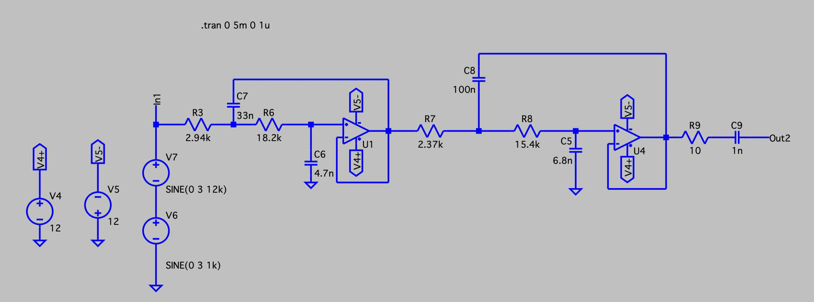
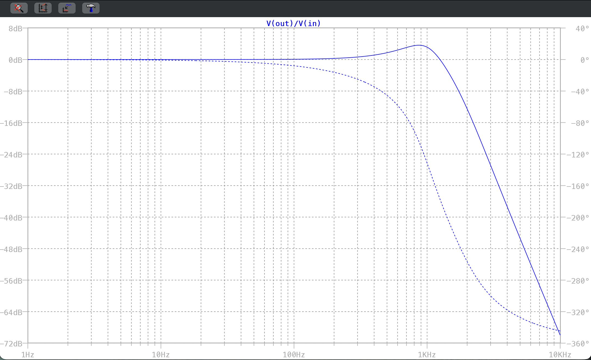
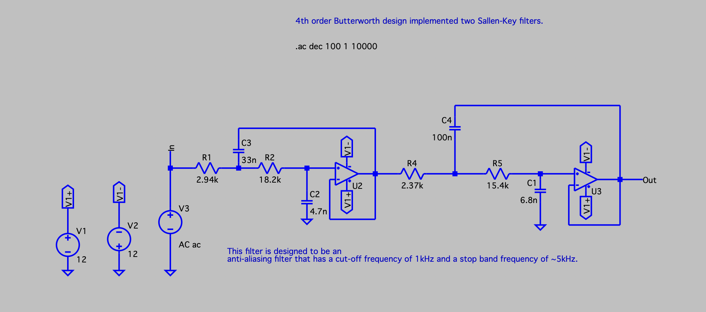
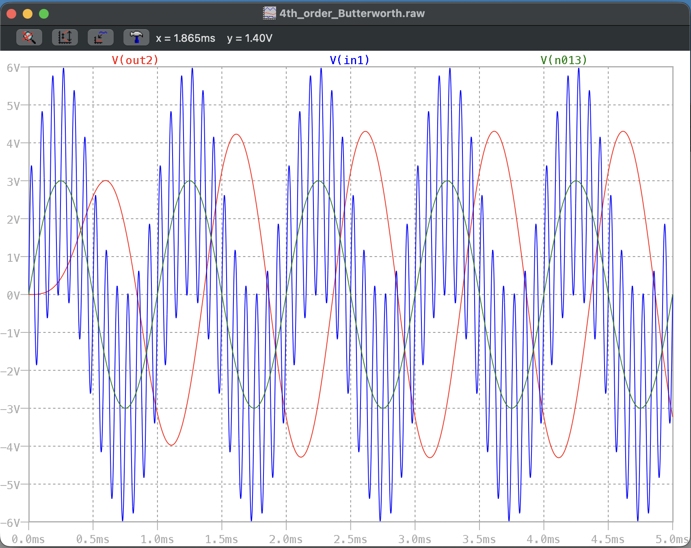

# Aktiver Anti-Aliasing-Filter (4. Ordnung, Butterworth) – LTspice Simulation

Dieses Repository enthält den Schaltungsentwurf und die LTspice-Simulationen eines aktiven Anti-Aliasing-Tiefpassfilters 4. Ordnung mit Butterworth-Charakteristik. Das Design basiert auf der Application Note **AN699** von Microchip Technology (*Bonnie C. Baker*).

---

## 📋 Projektübersicht & Technische Spezifikationen

Das Filter dient zur Bandbegrenzung analoger Signale vor der Analog-Digital-Wandlung (ADC), um Aliasing-Effekte durch hochfrequente Signalanteile oberhalb der Nyquist-Frequenz zu verhindern.

* **Filtertyp:** Aktiver Tiefpass (Sallen-Key-Topologie, 4. Ordnung)
* **Filtercharakteristik:** Butterworth
* **Grenzfrequenz (\(f_c\)):** 1 kHz
* **Sperrbereichsfrequenz (\(f_{stop}\)):** ~5 kHz
* **Dämpfung im Sperrbereich:** ca. 80 dB/Dekade (theoretisch 80 dB bei 10 kHz)
* **DC-Verstärkung:** 0 dB (V = 1, Spannungsfolger-Konfiguration)
* **Versorgungsspannung:** ±12 V Dual-Supply (`V1+` = +12 V, `V2-` = -12 V)

---

## 📖 Design-Grundlagen & Theorie

Bei der Auslegung von Anti-Aliasing-Filtern für Datenerfassungssysteme (Data Acquisition Systems) bietet ein **Butterworth-Design** einen flachen Amplitudengang im Durchlassbereich bei gleichzeitig steilem Abfall im Sperrbereich.

* **Kaskadierung:** Um eine Filterordnung von 4 zu erreichen, werden zwei Sallen-Key-Filterstufen 2. Ordnung in Reihe geschaltet.
* **Flankensteilheit:** Jede Stufe 2. Ordnung liefert 40 dB/Dekade; durch die Kaskadierung entsteht eine Gesamtdämpfung von **80 dB/Dekade** (entsprechend 80 dB Dämpfung eine Dekade oberhalb der 1 kHz Grenzfrequenz, also bei 10 kHz).
* **Bauteil-Dimensionierung (AC-Schaltplan):**
  * **Stufe 1 (`U2`):** `R1` = 2.94 kΩ, `R2` = 18.2 kΩ, `C3` = 33 nF (Feedback), `C2` = 4.7 nF (GND)
  * **Stufe 2 (`U3`):** `R4` = 2.37 kΩ, `R5` = 15.4 kΩ, `C4` = 100 nF (Feedback), `C1` = 6.8 nF (GND)

---

## 📊 Simulationsergebnisse

### 1. Frequenzgang (AC-Analyse / Bode-Diagramm)




* **Simulationsbefehl:** `.ac dec 100 1 10000` (Sweep von 1 Hz bis 10 kHz)
* **Amplitudengang (durchgezogene Linie `V(out)/V(in)`):**
  * Konstanter Pegel von **0 dB** im Durchlassbereich bis knapp unter 1 kHz (leichte Resonanzüberhöhung um ca. +3.5 dB bei ~900 Hz aufgrund der gewählten Bauteilwerte).
  * Steiler Abfall oberhalb der Grenzfrequenz: Bei 5 kHz liegt die Dämpfung bereits bei ca. **-47 dB**, bei 10 kHz erreicht sie **-70 dB**.
* **Phasengang (gestrichelte Linie):** Kontinuierliche Phasenverschiebung von 0° im Niederfrequenzbereich bis auf **-350°** bei 10 kHz (typisch für ein System 4. Ordnung mit maximal -360°).

---

### 2. Zeitbereichsverhalten (Transientenanalyse)




* **Simulationsbefehl:** `.tran 0 5m 0 1u`
* **Testaufbau:** Ein 1 kHz Nutzsignal (3 V Amplitude) wird mit einem hochfrequenten 12 kHz Störsignal (3 V Amplitude) überlagert (Gesamthub ±6 V).
* **Signalverläufe:**
  * **Grün `V(n013)`:** Reines 1 kHz Nutzsignal.
  * **Blau `V(in1)`:** Verrauschtes Eingangssignal (1 kHz + 12 kHz).
  * **Rot `V(out2)`:** Gefiltertes Ausgangssignal – die 12 kHz Störfrequenz wird vollständig unterdrückt; am Ausgang erscheint ein sauberer 1 kHz Sinus.

---

## 📂 Repository-Struktur

```text
├── schematics/
│   ├── 4th_order_Butterworth_AC.asc     # Schaltplan für AC-Analyse (Bode-Plot)
│   └── 4th_order_Butterworth_Tran.asc   # Schaltplan für Transientenanalyse
├── docs/
│   ├── ac_schematic.png                 # Schaltplan AC-Simulation
│   ├── bode_plot.png                    # Frequenz- und Phasengang
│   ├── transient_schematic.png          # Schaltplan Zeitbereich
│   └── transient_plot.png               # Zeitbereichs-Plot
└── README.md
```

---

## 🚀 Simulation in LTspice ausführen

1. Gewünschte `.asc`-Datei in **LTspice** öffnen.
2. Über **Simulate > Run** die Simulation starten und die Knoten `In` bzw. `Out` im Schaltplan anklicken.

---

## 📚 Quellen & Referenzen

* **Bonnie C. Baker:** *Anti-Aliasing, Analog Filters for Data Acquisition Systems*, Application Note **AN699**, Microchip Technology Inc. (Figure 17 & Figure 18: *4th Order Butterworth Design*).
